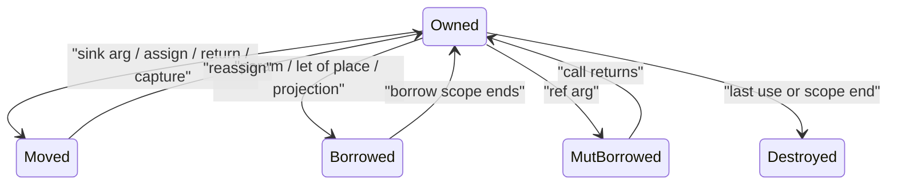

# Design note: unique-by-default ownership

Decision record for replacing shared-by-default ARC classes with unique ownership. Non-`shared`
classes, strings, arrays and collections have exactly one owner at a time. The compiler frees
them at a statically known point with no reference count, and needs no lifetime syntax to do it.
`shared class` is the only reference-counted type.

This note supersedes the sink-default ABI, borrow inference and cursor-local sections of
[11 — Ownership and memory performance](11-swift-like-arc-roadmap.md). The permanent non-goals in
[10 — Rejected: SSO / class `@stack` / size-class mono](10-stack-alloc-and-mono-design-note.md)
still stand: unique ownership changes who frees an object, not its representation.

## 1. Why "no reference count and no annotations" needs a restriction

A compiler that frees every object without runtime bookkeeping has to know, at compile time, the
exact point where each object's last reference dies. With unrestricted aliasing that is
undecidable:

```dream
let n = Node(1);
list.set(read_int(), n);
list.set(read_int(), n);
list.remove_at(read_int());
// Whether the Node is dead now depends on all three inputs.
```

More generally, "is this heap object reachable at this program point?" reduces to the halting
problem, so by Rice's theorem every memory scheme must give up one of three things:

1. **Pay at runtime.** Reference counting (Swift, Dream before this note) or tracing collection.
2. **Reject programs.** Rust (single owner plus lifetime-checked borrows) and Hylo/Mojo (mutable
   value semantics: references cannot be stored, so no lifetimes are written).
3. **Free late or leak.** Region inference, arenas.

Dream takes option 2 in the Hylo form. Unique values have one owner, so the last owner is always
known statically and the backend emits a direct destroy. Borrows are second-class, so a borrow can
never outlive the scope or statement that created it and no lifetime has to be named. Programs
that genuinely need aliasing opt into option 1 with `shared class`.

## 2. Type categories

Every type falls into exactly one category. The interner answers with `is_trivially_copyable`,
`is_unique_type` and `is_shared_type`.

| Category | Types | Implicit copy | Freed by |
|---|---|---|---|
| Trivially copyable | scalars, plain `enum`, value `struct`s whose fields are all trivially copyable, `shared class` references, `js` handles | yes (bitwise; a `shared` or `js` copy retains) | nothing / count reaching zero |
| Unique | non-`shared` classes, `string`, `T[]`, `List`/`Map`/`Set` and the other collection classes, interfaces, unions and `Option`s with a unique payload, value `struct`s with a unique field, function values | no: move or `.copy()` | static destroy at the owner's last use |
| Shared | `shared class` | yes (retain) | atomic count reaching zero |

String literals are unique values backed by immortal storage; destroying one is a no-op.

## 3. Rules

### Parameters

Users do not write ownership modes on ordinary parameters. The analyzer infers each parameter's
mode from the function body, the same way it already infers receiver modes for `this`:

- **Inferred sink:** the body stores the parameter (field, element, global, escaping capture),
  returns it, moves it into a local that escapes, or passes it to another sink parameter.
- **Inferred borrow:** every other parameter.
- **Always sink while counts remain:** a parameter whose destruction may run a `del` (the type, a
  strongly held part, or an erased `object`/interface/function value). Under reference counting a
  borrowed argument with a `del` is released at the caller's block end rather than when the call
  returns, so inferring borrow would move an observable destructor, and objects with a `del` can
  be reached from outside the frame (a cancellation token's source, a pending host operation).
  Static destroy at the owner's last use lifts this once unique types stop counting.
- `ref name: T` stays explicit: it is an exclusive mutable borrow of the caller's place, and the
  call site writes `ref x`.

Rust needs `&` in signatures because it compiles crates separately and a caller sees only the
signature. Dream analyzes the whole program, including the stdlib, so every body is available.
Inference runs once over the call graph: strongly connected components (recursive and mutually
recursive functions) iterate to a fixed point, starting from borrow and only ever moving a
parameter to sink. Generic functions are inferred once on their generic body; a parameter whose
type is trivially copyable has no observable mode.

Declarations without a body cannot be inferred:

- Interface methods default to borrow. An implementation whose inferred mode is sink where the
  interface says borrow is an error that points at the storing line, as receiver-mode mismatches
  are today.
- `extern` functions and function types (`fun(T): R`) default to borrow.
- The optional `sink` keyword (contextual: `sink name: T`) declares sink in these places, and pins a
  contract on an ordinary function. A body that would infer sink under an explicit `borrow`
  contract is an error.

The `borrow` parameter keyword stays only as an explicit contract pin, mirroring `borrow fun`.

Because a parameter mode is part of what callers see, editing a body to start storing a parameter
can turn a caller's later use into a use-after-move error. The diagnostic names the line in the
callee that made the parameter a sink:

```text
error: 'xs' was moved into 'Bag'
  note: 'Bag' takes ownership of 'items' because it stores it here: this.items = items
  help: pass 'xs.copy()' to keep using 'xs'
```

The language server shows inferred modes as inlay hints (`items: sink List<int>`).

### Moves

A unique value moves when it is passed to a sink parameter (inferred or declared), assigned to a local, field, element
or global, returned, captured by an escaping closure, or sent to a `Task`. Afterwards the source
local is **moved**; reading it is an error that suggests `.copy()`. A move on only some paths
leaves the local **maybe moved**, which is also an error to read. Assigning a new value revives the
local. Destroying the previous occupant of a reassigned owner happens at the assignment.

Fields and elements are never left moved-from. Moving out of a place requires an API that leaves a
valid value behind: `take`, `swap`, `pop`, `drain`, `Option.take`.

### Bindings of places

`let x = <field or index place>` with a unique type is an **inferred borrow** when `x` is only
read. Reassigning `x` to another place rebinds the borrow (this is how traversal loops work). If
`x` is moved, stored, mutated or returned, the binding is an error:
`cannot move out of 'people[0]'` with the help `use 'take', 'swap', or '.copy()'`.

`let x = <local>` moves the local. `let x = <call or constructor>` owns the result.

### Projections

A method may return `borrow T`, meaning the result (and every unique value reachable from it) is
borrowed from `this`. That is the only borrowed return; there is no way to return a borrow of a
parameter, so no lifetime is ever ambiguous.

```dream
public fun this[index: int]: borrow T {
    ...
}

public fun get(key: K): borrow Option<V> {
    ...
}

public fun first(): borrow Option<T> {
    ...
}
```

The caller's borrow of `this` lasts as long as the projection is live. An `Option` projection holds
a borrowed payload; matching `Some(v)` binds `v` as a borrow.

### Exclusivity

At every program point, each place has either any number of immutable borrows or exactly one
mutable borrow, and a borrowed place cannot be moved or reassigned. Places overlap by path prefix:
`a` overlaps `a.b` and `a.b.c`; `a[i]` overlaps every `a[j]`, since indices are not compared.

```dream
let n = names[0];
names.push("b"); // error: cannot mutate 'names' while 'n' borrows it
System.println(n);

swap_x(ref p, ref p); // error: 'p' is borrowed mutably twice in one call
```

### Copies

`.copy()` is a compiler-derived deep copy of a unique value. Classes with `del()` are not
copyable: the destructor usually guards an external resource. Generic code may call `.copy()` on
`T` only under the constraint `T: copyable`; trivially copyable types satisfy it trivially.

### Closures

- A lambda passed directly to a function-typed parameter of the callee is **non-escaping**: it may
  borrow and mutably borrow its captures, and exclusivity is checked across the whole call.
- Every other lambda is **escaping**: unique captures move into it. A captured local is owned by
  the closure; the outer scope can no longer read it. `CaptureCell` sharing remains only for
  trivially copyable and shared captures.
- A function value is itself unique.

### Async functions and tasks

- An `async fun` may take borrowed parameters, and async methods borrow `this`. The future such a
  call returns holds those borrows, so it is second-class: a call that borrows a unique argument
  (or the receiver) must be awaited in the same expression, `f(x).await`. Storing, returning or
  spawning that future is an error: `this future borrows 'x'; await it here or pass 'x.copy()'`.
  Calls whose unique arguments all go to sink parameters return ordinary futures.
- `ref` parameters follow the same rule: the mutable borrow lasts until the immediate `.await`
  completes.
- Borrows of frame-owned locals may cross `.await`; the frame owns both the value and the borrow.
- Task bodies move their unique captures and may capture `shared` values. A unique value is
  reachable from one thread at a time, so data races on unique values are impossible.

### Cycles and weak references

A unique graph is a tree: making `a` a child of its own descendant moves `a` while the assignment
target borrows it, which exclusivity rejects. Consequently:

- `unowned` is removed.
- `weak` fields and locals require a `shared class` target.
- `@allow_cycle` and the cycle checker apply only to `shared class` graphs.

Parent links, observers and caches use `shared class` with `weak`, or indices into a collection.

## 4. What the compiler emits



The semantic analyzer runs the ownership checker over HIR and records each decision in HIR: moves,
copies, borrows, projections and destroy points. MIR never re-derives ownership.

- **Moves** are bitwise copies of the pointer. A conditionally moved owner gets a drop flag (the
  local is nulled on the moving path and the destroy checks it).
- **Destroys** of unique values are a direct `destroy_<T>` call: no count load, no last-reference
  branch. Destroy glue calls `destroy_*` for unique fields and `release_*` for shared fields.
- **Reference counting** (`RcInsertion` and `RcElision`) runs only on `shared class` and `js` values.
- **Release glue** is generated only for shared and `js` types. **Copy glue** is generated on demand,
  for types reachable from a `.copy()` call that survives optimization.

The passes whose only purpose was removing reference counting from what are now unique values are
deleted: parameter-mode inference, cursor locals and cursor families, held-by-owner elision, read
loans, borrowed fields, value borrow cover and the unique-region candidate proofs.

## 5. Performance consequences

These follow directly from the rules and need no new syntax.

### `noalias` on parameters

While a function runs, nothing else reads or writes the memory behind a `ref` parameter, and
nothing writes the memory behind a borrowed unique parameter. That is exactly what LLVM's
`noalias` requires, so the backend emits `noalias` on `ref` parameters and `noalias readonly` on
borrowed unique parameters. Shared, `js` and trivially copyable parameters get no attribute. This
satisfies the backend rule that an attribute is added only when Dream semantics prove it
([06 — LLVM backend](06-llvm-backend.md)). A hole in the exclusivity checker would turn into a
miscompile, so the attributes land only after the checker's diagnostic fixtures pass, and the
aliasing probes run optimized under native ASan.

```dream
fun add_into(ref dst: float[], src: float[]): void {
    for (let i = 0; i < dst.length; i = i + 1) {
        dst[i] = dst[i] + src[i];
    }
}
```

### Smaller headers and size classes

Unique objects never touch a reference count, so they carry an 8-byte common header: the
type-info and size-class word plus the tag. Shared and `js` objects add a count prefix in front of
it; the tag stays at a fixed offset from the payload, so tag dispatch on an erased object works
for both. The immortal marker moves from the count into a tag bit.

Native and wasm32 size classes use 8-byte steps up to 128 bytes, then 16-byte steps to 256, so the
smaller header saves memory for every small object:

| Object data | Old block | New block |
|---|---|---|
| 8 bytes | 32 | 16 |
| 16 bytes | 32 | 24 |
| 24 bytes | 48 | 32 |

### Stack allocation

Frame allocation is driven by the analyzer's move facts instead of escape analysis. A unique local
below the size limit that is never moved out of its function lives in the stack frame, including
classes with `del()` (the destructor runs at the known destroy point). Objects created in a loop
reuse one slot per iteration. Async frames and region objects stay on the heap.

## 6. User-facing examples

### Assignment moves; copies are explicit

```dream
class Point {
    public x: int;

    public constructor(x: int) {
        this.x = x;
    }
}

fun points(): void {
    let p = Point(1);
    let q = p; // moves: q is now the only owner
    q.x = 9;
    System.println(p.x); // error: 'p' was moved; use 'p.copy()' to keep both

    let a = Point(1);
    let b = a.copy();
    b.x = 9;
    System.println(a.x); // 1
}
```

### Parameters

```dream
fun describe(p: Point): string {
    return $"Point({p.x})";
}

fun nudge(ref p: Point): void {
    p.x = p.x + 1;
}

class Shape {
    public corner: Point;

    public constructor(corner: Point) { // stored: inferred sink
        this.corner = corner;
    }
}

fun calls(): void {
    let p = Point(1);
    System.println(describe(p)); // inferred borrow: p is still usable
    nudge(ref p);
    let shape = Shape(p); // p moves into the shape
    System.println(p.x); // error: 'p' was moved into 'Shape'
//   note: 'Shape' stores 'corner' here: this.corner = corner
//   help: pass 'p.copy()' to keep using 'p'
}
```

### Collections

```dream
import system.collections;

fun people(archive: List<Person>): void {
    let people = List<Person>();
    people.push(Person("Ana"));
    people.push(Person("Bo"));

    System.println(people[0].name);

    let first = people[0]; // only read: inferred borrow
    System.println(first.name);

    let ana = people.take(0);
    let bo = people[0].copy();

    for (let p in people) {
        System.println(p.name);
    }

    for (let p in people.drain()) {
        archive.push(p);
    }
}
```

### Trees

```dream
class Node {
    public value: int;
    public next: Option<Node>;

    public constructor(value: int) {
        this.value = value;
        this.next = Option.None;
    }
}

fun print_all(head: Node): void {
    let curr = head.next; // borrow; rebinding below walks the chain
    while curr.is_some() {
        let node = curr.unwrap();
        System.println(node.value);
        curr = node.next;
    }
}
```

### Sharing

```dream
shared class Window {
    public title: string;
    public weak parent: Option<Window>;

    public constructor(title: string) {
        this.title = title;
        this.parent = Option.None;
    }
}

fun windows(): void {
    let root = Window("main");
    let child = Window("dialog");
    child.parent = Option.Some(root);
    let alias = root; // shared: the copy retains
    System.println(alias.title);
}
```

### Closures and tasks

```dream
fun closures(items: List<int>): void {
    let total = 0;
    items.for_each(
        (x) => {
            total = total + x; // non-escaping: may mutate the capture
        }
    );

    let label = "count";
    let printer = () => {
        System.println(label); // escaping: 'label' moves in
    };
    System.println(label); // error: 'label' was moved into the closure
}

async fun save(doc: Document, stream: MemoryStream): Result<int, IoError> {
    let data = doc.data; // inferred borrow of the caller's document
    stream.write_async(data).await?;
    return Result.Ok(data.length); // the borrow may cross the await
}

async fun start(doc: Document, stream: MemoryStream): void {
    let pending = save(doc, stream);
// error: this future borrows 'doc'; await it here or pass 'doc.copy()'
}
```

## 7. Migration

There is no compatibility path. Every program, test, sample and stdlib file migrates:

- Ordinary parameters need no edits: modes are inferred. Interface methods, `extern` functions and
  function types whose implementations store a parameter gain `sink`. Explicit `borrow` parameter
  modifiers that only restate the inferred mode are deleted.
- Aliased class graphs become `shared class` or restructure into trees or indices.
- Indexers and getters return `borrow T`; element moves use `take`, `swap`, `pop` and `drain`.
- `@borrowed_result` is replaced by the `: borrow T` return modifier, still limited to standard
  library slot getters until the exclusivity checker can validate user projections.
- `unowned` fields become `weak` fields of a `shared class`, or are restructured.

## 8. Open follow-ups

- The closed-graph rule for `shared class` fields stays as it is, so a `shared class` cannot own
  unique fields yet. Relaxing it needs a story for mutation through shared references.
- Index-precise exclusivity (`a[0]` versus `a[1]`) is not attempted; disjoint element access goes
  through APIs such as `swap` or split views.
